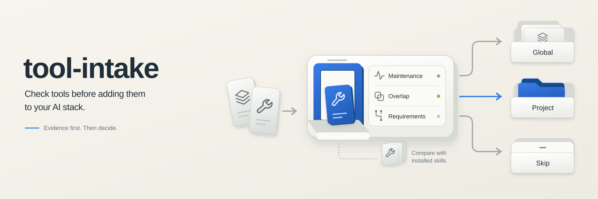

<p align="center">
  <picture>
    <source media="(prefers-color-scheme: dark)" srcset="assets/banner-dark.svg">
    
  </picture>
</p>

[](https://skills.sh/hong-tm/tool-intake)

An agent skill for deciding whether a new tool, skill, or repository belongs in your agent stack, and a read-only script that gathers the evidence first.

## Install

```bash
npx skills add hong-tm/tool-intake
```

Or copy this folder into your agent's skill directory (for example `~/.agents/skills/`).

## Why

Agents and people install tools from a one-line description. That is how a stack ends up with two skills doing the same job, a project-specific skill loaded globally, and an install that breaks the host because it needed root, a browser engine, or a runtime that is not on the service PATH.

This skill replaces improvisation with a fixed procedure and an evidence step.

## What the skill enforces

1. Run the audit script and look at the evidence before judging.
2. Read the candidate's full text, never just the blurb. One-line registry descriptions mislead.
3. One copy per function. If something installed already covers it, decline or state the concrete difference.
4. Pick a scope: user-global, project-level, or decline. Cross-project tools only go global.
5. Preflight compatibility: output protocol versus the viewing surface, privilege requirements, resident footprint, runtime reachability under systemd and cron.
6. Install, then verify the real loader picks the skill up with no name collisions. A directory entry is not an install.
7. Record the decision durably. Decisions that live only in chat get re-litigated.

## The audit script

`scripts/intake_audit.py` is read-only and standard-library only (Python 3.10+). It never modifies files and never installs anything.

```bash
python3 scripts/intake_audit.py https://github.com/owner/repo
python3 scripts/intake_audit.py ./local/path --keywords secret,scan,redact
python3 scripts/intake_audit.py owner/repo --roots /opt/skills
python3 scripts/intake_audit.py --keywords webhook,retry --json
python3 scripts/intake_audit.py https://github.com/owner/repo --no-network
```

It reports four things:

- **Upstream vitality**: stars, license, last push, archived flag, open issues (unauthenticated GitHub API; `--no-network` skips it).
- **Preflight red flags** in the project text: sudo or root requirements, heavy dependencies, daemons, mandatory credentials.
- **Installed-skill inventory**: auto-detected skill roots plus any `--roots` extras, including an ancestor walk from the current directory so workspace layers are not missed.
- **Duplicate-function scan**: overlap between the candidate's keywords and every installed skill's name and description, ranked `strong` / `overlap` / `weak`.

Auto-detected roots: `~/.agents/skills`, `~/.claude/skills`, `~/.codex/skills`, `~/.config/opencode/skills`, `~/.gemini/skills`, plus `.agents/skills`, `.claude/skills`, `.codex/skills`, and `.opencode/skill` found while walking up from the current directory.

### Sample output

```text
# Tool intake audit

- Target: https://github.com/owner/candidate-tool
- Generated: 2026-10-13 00:07
- Read-only: no file was modified

## 1. Upstream vitality
- Repo: owner/candidate-tool
- Stars: 1 | Forks: 0 | Open issues: 0
- License: Apache-2.0 | Archived: no
- Created: 2026-04-30 | Last push: 2026-09-29 (14 days ago)

### Preflight red flags in project text
- credential needed: 1 kind(s) seen -> credential
- python runtime: 2 kind(s) seen -> pip install, pipx install

## 2. Installed skill inventory
- ~/.agents/skills (30 skill(s))
- ~/.claude/skills (32 skill(s))
- Total distinct skills: 69

## 3. Duplicate-function scan
- Keywords considered: 88 | matched: credentials, logs, redact, scan, secrets, session

| skill | root | matched tokens | strength |
|---|---|---|---|
| secret-sweep | ~/.agents/skills | credentials, logs, redact, scan, secrets, session | strong |

## 4. Verdict skeleton (fill in)
- decision: install | decline
- scope: user-global | project | archive
- reason:
- date:
```

## Layout

```text
SKILL.md
scripts/intake_audit.py
```

## License

MIT
